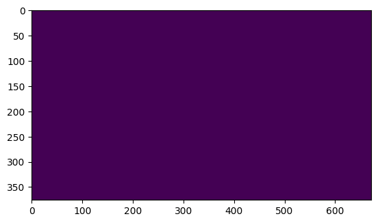

# Droid Environment / Data Adaptor for UniEnv

This repository contains the implementation of the adaptor that connects the Droid environment and dataset to the UniEnv interface.

To install the adaptor, you can simply install this package from PyPI:

```bash
pip install unienv-droid[dataset,env]
```

You can specify the features that you want to install through the optional dependencies. For example, if you only want to install the dataset related code, you can do:

```bash
pip install unienv-droid[dataset]
```

## Usage of Droid Environment Wrapper

```python
from unienv_droid import DroidEnv
from droid.robot_env import RobotEnv as DroidRobotEnv

# Create the underlying Droid RobotEnv
robotenv = DroidRobotEnv()

# Create the DroidEnv wrapper
env = DroidEnv(robotenv)

# Now you can use the env as a standard UniEnv environment
ctx, obs, info = env.reset()
while True:
    action = env.sample_action()
    ctx, obs, reward, terminated, truncated, info = env.step(action)
    if terminated or truncated:
        break
```


## Usage of Droid Raw Data to retrieve depth


> Please be aware of a bug in the SVO reading code that may cause the last few frames of the SVO recording to be noise when you only read a subset of frames in an episode. This is caused by a bug in the PyZed SDK and there's really nothing we can do about it. 

First download the raw dataset

```bash
gsutil -m cp -r gs://gresearch/robotics/droid_raw/v1.0.1 <path_to_target_dir>
```

Then download the additional updated annotations for droid from [huggingface](https://huggingface.co/KarlP/droid), and unzip it and place it in `<path_to_annotation_dir>`.

```python
from unienv_droid_data.raw import RawDroidDataset
import numpy as np

path_to_target_dir = "<path_to_target_dir>" # Replace with the path where you downloaded the droid raw data
path_to_annotation_dir = "<path_to_annotation_dir>" # Replace with the path where you placed the droid annotations

dataset = RawDroidDataset(
    root_dir=path_to_target_dir, 
    droid_annotations_path=path_to_annotation_dir,
    target_resolution=sl.Resolution(672, 376), 
    success_only=True, # Only load successful episodes
    read_right=False # Whether to read additional right camera images from the stereo camera
)

# Access dataset properties
print("Raw dataset length:", len(dataset))
print("Raw dataset space:", dataset.single_space)
print("Metadata space:", dataset.single_metadata_space)

# Access data
first_step_data = dataset[0]

# Access slices of data
first_ten_steps = dataset[:10]

# Access data through indexes
indexed_data = dataset[np.array([0, 5, 10, 15])]

# Access data and metadata
first_step_data, first_step_metadata = dataset.get_at_with_metadata(0)

# Access slice of data and metadata
first_ten_steps_data, first_ten_steps_metadata = dataset.get_at_with_metadata(slice(10))

# Access trajectory (trajectory doesn't support slices)
print("Trajectory length:", dataset.trajectory_length)
first_trajectory_data = dataset.get_trajectory_at(0)
first_trajectory_data, first_trajectory_metadata = dataset.get_trajectory_at_with_metadata(0)
```

Note that for the resolution we picked the VGA resolution, instead you can pick any resolution supported by ZED. 
See [Zed SDK Documentation](https://www.stereolabs.com/docs/api/group__Video__group.html#gabd0374c748530a64a72872c43b2cc828) for complete list of supported resolutions.